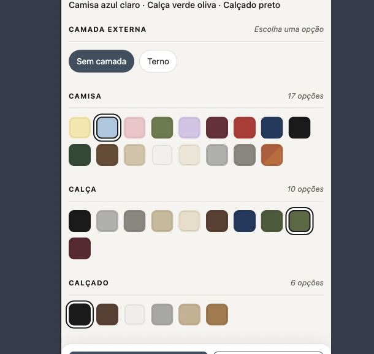

# Wardrobe
Combinação de roupas para escolher

Para gerar e validar novos looks com um prompt reutilizável, consulte [PROMPT-GERAR-LOOKS.md](PROMPT-GERAR-LOOKS.md).

## Organização dos arquivos

Os documentos Markdown e o `index.html` ficam na raiz. Os demais arquivos são agrupados por função:

```text
wardrobe/
├── *.md
├── index.html
├── assets/
│   ├── css/styles.css
│   └── js/
│       ├── script.js
│       ├── combinator.js
│       └── comparison.js
├── data/gpt-index.json
├── docs/images/
├── scripts/
│   ├── build_index.py
│   ├── convert_looks_to_webp.py
│   └── crop.py
└── gpt/
    ├── compressed/
    ├── raws/
    ├── references/
    └── to_crop/
```

Execute os comandos abaixo a partir da raiz do projeto:

```sh
python3 scripts/crop.py
python3 scripts/convert_looks_to_webp.py
python3 scripts/build_index.py
```

O recorte usa `gpt/to_crop/` e salva os PNGs finais em `gpt/`; a conversão cria os WebPs em `gpt/compressed/`. O índice gerado em `data/gpt-index.json` alimenta o combinador em `assets/js/combinator.js`; `assets/js/script.js` cuida dos favoritos e guias.

O ícone de duas fotos no combinador inicia a comparação em `assets/js/comparison.js`: o look A fica fixo enquanto as cores alteram o look B. No desktop, as fotos aparecem lado a lado; no celular, use A/B para alternar. Cada look pode ser favoritado ou ampliado. O × encerra a comparação e mantém o look B; a referência fica apenas na memória até recarregar a página.

Não precisa gerar todos os tipos de calçados e nem todos os tipos de roupas.

Colocar isso no header do site para eu lembrar

A combinação de cores ficou boa - camisa, calça, sapato...? 
- Vai servir tanto para camisetas, polos, suéteres, gola alta (turtleneck) etc. 
- Também serve para shorts, bermudas...
- Também serve para calçados: botas, loafers, tênis...
- *O CONCEITO BASTA; A COMBINAÇÃO TER FICADO BOA BASTA.*


CAMISA

Amarelo claro ✅ 
Azul claro ✅ 
Rosa claro  ✅ 
Verde Oliva ✅ 
Lilas claro ✅ 

Vinho ✅ 
Vermelho ✅ 

Azul Marinho ✅ 
Preto ✅ 
Verde Escuro ✅ 

Marrom ✅ 

Bege ✅ 
Branco/Off-white ✅ 
Creme  ✅ 
Cinza claro ✅ 
Cinza pedra ✅ 


Cáqui X -> reduzir a creme
Chumbo X -> reduzir a cinza pedra

Vermelho Ferrugem / Terracota ✅
Mostarda
Verde Eucalipto
Azul Petróleo


Gerar looks mesmos looks atuais com
- Tênis branco ✅ 
- Tênis preto -> sapato preto já basta para saber se presta
- Preencher faltantes de preto ✅ 
- Preencher faltantes de marrom ✅ 
- calcado caramelo
- calcado cinza claro ✅
- calcado azul claro
- calcado marinho X

# Não precisa gerar para todos os tipos de calçados
Se ficou bom com sapato de cor X, ficará bom com bota e outros tipos de calçado com cor X.

Só basta validar a cor. O modelo do calçado em si não importa muito.

# Não precisa gerar para outros tipos de peças de baixo
Se a combinação de cor ficou boa para calça, também fica para short.

# Não precisa gerar para outros tipos de camisas
Se fica bom com manga longa a cor, então não precisa gerar para t-shirt, polo, suéter.

A COR PROVA A COMBINAÇÃO.

Depois looks com 
- jaqueta de couro preta / marrom [off] 
- bomber Jacket preta / verde / azul [off]
- terno ✅
- blazer por cima [deixar off]


## Decisões do combinador — blazer e jaqueta temporariamente desativados

Blazer e jaqueta foram removidos do seletor do combinador por enquanto. **Não apagar as imagens existentes**: elas permanecem na galeria e as decisões abaixo permitem restaurar as opções quando solicitado.

### Regras gerais para restaurar

- Camada externa é mutuamente exclusiva: “Sem camada”, “Terno”, “Blazer” ou “Jaqueta”.
- Usar a mesma fileira única de amostras de camisa, calça e calçado; a camada selecionada apenas filtra as cores não permitidas. Não criar fileiras duplicadas para configurar permissões.
- “Sem camada” remove os filtros e restaura todas as cores originais.
- Manter os contadores sincronizados com as amostras visíveis.
- Terno continua ativo no combinador: esconde calça e filtra as peças conforme definido abaixo.

### Blazer

- Cores do blazer: marinho médio, marinho escuro, cinza, bege, grafite, branco, marrom.
- Camisas permitidas: azul claro, rosa claro, branco/off-white, bege, preta, azul marinho, marrom, verde oliva e vinho. “Branco” listado duas vezes foi tratado como uma só opção.
- Calças: a lista específica ainda não foi definida; até informar as cores desejadas, manter todas disponíveis.
- Calçados: todas as cores disponíveis no seletor de calçados.

### Jaqueta

- Cores da jaqueta: preta, marrom, caramelo e bege. A lista anterior preta/marrom/verde/azul foi substituída por esta.
- Camisas, calças e calçados permitidos: usar as mesmas listas definidas para blazer, inclusive manter todas as calças disponíveis enquanto a lista específica não for definida.

### Terno (permanece ativo)

- Cores que têm imagens de terno no repositório: azul claro, azul marinho, bege, branco, cáqui, caramelo, cinza claro, cinza pedra, ferrugem, lilás, marrom, preto, verde oliva e vinho.
- Camisas permitidas: azul claro, rosa claro, branco, lilás claro (`lilas` no nome do arquivo), preta (`preta`), verde oliva (`verde-oliva`), amarelo claro (`amarela`) e vinho (`vinho`). As séries amarelo claro e vinho estão completas, com 84 combinações cada (14 ternos × 6 calçados).
- Calçados permitidos: bege, caramelo, cinza claro, marrom, preto e tênis branco.
- Não mostrar seletor de calça em modo terno.

### Imagens conhecidas para blazer/jaqueta

- `gpt/references/blazer-azul-marinho-camisa-azul-claro-calca-bege-calcado-marrom.png`
- `gpt/references/jaqueta-preta-camisa-preta-calca-preta-calcado-preto.png`

## Conversão de looks PNG para WebP

Gere novos PNGs diretamente na raiz de `gpt/`. Execute `python3 scripts/convert_looks_to_webp.py` para converter esses PNGs para WebP em `gpt/compressed/`. O script não percorre subpastas: `gpt/raws/` guarda os originais e fica fora da conversão; `gpt/references/` também não é processado. O script usa Pillow (instale com `python3 -m pip install Pillow` se necessário), qualidade padrão 82 e método de codificação 6. A qualidade pode ser alterada com `--quality 1-100`.

Os PNGs gerados na raiz são preservados. Se o WebP de destino já existir, o script o mantém e pula a conversão daquele arquivo. `scripts/build_index.py` combina os looks PNG da raiz com os WebP já existentes em `gpt/compressed/`; ignora `gpt/raws/` e `gpt/references/`. O combinador e os favoritos usam os nomes dos arquivos como identificadores e carregam as imagens de `gpt/compressed/`, sem depender dos RAWs.

Para o prompt agnóstico e o fluxo de revisão antes de gerar lotes, consulte [PROMPT-GERAR-LOOKS.md](PROMPT-GERAR-LOOKS.md).


## melhorias visuais
- Testar na versão mobile:
    - carossel de cores ao invés de wrap line, visando ganhar mais visibilidade sobre a foto, mesmo durante a seleção de cores.
    - 

- organizar os arquivos desse projeto. Estão muito bagunçados.
    - colocar catalog, filters, paleta etc num arquivo separado -> talvez de constantes.

- Mudar texto: Salvar favorito -> Favoritar. Remover favorito -> Desfavoritar.


## DONE
- adicionar aba Guia ao lado de Favoritos, com seções expansíveis de tecidos, cores e calçados
- substituir Galeria por Favoritos; salvar imagem e nome de cada look no localStorage deste navegador e permitir removê-los da lista
- preciso dar dois cliques para voltar de ternos para sem camada -> não deveria precisar disso.
- página inicial deve ser o combinador.
- remover botão de reset e aleatório
- abaixo da foto de cada look tem o nome das peças e cores. Antes de cada nome colocar um círculo pequeno com a cor.
    - 
- Cor selecionada aparece o nome dela em baixo ou no headline da seção. Testar uma por vez ver qual gosto mais.
    -  <- vencedora
    - 
